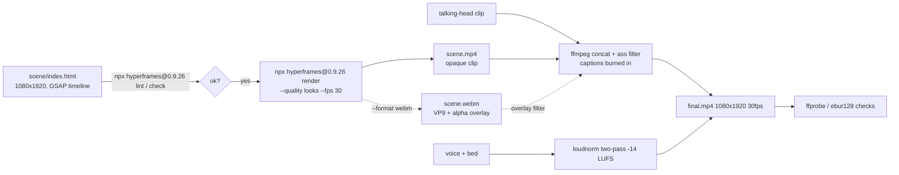

# ADR 0002: Render path (HyperFrames scene to ffmpeg assembly)

Status: proposed (pending user acceptance)
Date: 2026-11-09
Spike: `spikes/s2-render/` (`node spikes/s2-render/run.ts`, results in `spikes/s2-render/report.md`)

## Decision

Motion-graphic scenes are authored as HyperFrames HTML compositions and rendered headless to clips by the external `npx hyperframes@0.9.26 render` CLI (Apache 2.0, never vendored; no blocks or templates copied). ffmpeg then assembles clips, captions and audio. mostudio spawns both with `shell: false` and argument arrays.



## Working commands (run from repo root)

```
npx hyperframes@0.9.26 lint spikes/s2-render/scene
npx hyperframes@0.9.26 check --json            # from inside the scene dir; gate on .ok
npx hyperframes@0.9.26 render spikes/s2-render/scene --quality looks --fps 30 --format mp4 -o spikes/s2-render/media/scene.mp4 --quiet
npx hyperframes@0.9.26 render spikes/s2-render/scene --quality draft --fps 30 --format webm -o spikes/s2-render/media/scene-alpha.webm --quiet
```

The portrait size comes from the scene itself: `<meta viewport width=1080,height=1920>` and the root's `data-width="1080" data-height="1920"` (`npx hyperframes init scene --resolution portrait` scaffolds this). Assembly (full argument lists in `report.md`):

- stand-in: `ffmpeg -f lavfi -i testsrc2=size=1080x1920:rate=30:duration=10 -c:v libx264 -pix_fmt yuv420p`
- concat + captions: `[0:v]fps=30,format=yuv420p,setsar=1[a0];[2:v]fps=30,scale=1080:1920,format=yuv420p,setsar=1[a1];[a0][a1]concat=n=2:v=1:a=0[cat];[cat]ass=<file>.ass[v]`
- audio: `apad` voice to 15 s, `amix` with pink-noise bed, `loudnorm=I=-14:TP=-1.5:LRA=11` in two passes (measure with `print_format=json`, apply with `measured_*`, `linear=true`)
- encode: `-c:v libx264 -crf 18 -pix_fmt yuv420p -r 30 -c:a aac -b:a 192k -t 15 -movflags +faststart`

## Measured (machine, Node and HyperFrames versions are recorded in the `report.md` header)

| Metric | Value |
| --- | --- |
| Render time, 5 s scene, `--quality looks` | 13.0 s (draft: 8.3 s); other runs of the spike varied 9 to 13 s, so treat it as roughly 10 s |
| Final size / fps / duration | 1080x1920 / 30.000 / 15.000 s |
| Integrated loudness (ebur128) | -14.0 LUFS |
| A/V start offset | -21.3 ms (measured; likely explained by standard AAC encoder priming of 1024 samples at 48 kHz = 21.3 ms, an explanation not a measurement; inside the 40 ms budget) |

Numbers are from the committed `report.md` run (HyperFrames version recorded there). A render has fixed per-run cost (Chrome launch, compile, setup; a 5 s scene takes about as long as its draft/looks wall time above), so per-scene overhead likely dominates short clips: batch scenes or render long compositions rather than many tiny ones.

## Alpha / transparent clips: yes

`render --format webm` (VP9) and `--format mov` (ProRes 4444, default profile) render with transparency; `png-sequence` writes RGBA frames. Verified: with the scene's background removed, the decoded WebM (`ffmpeg -c:v libvpx-vp9 -i x.webm`, pix_fmt `yuva420p`) has alpha 0 at an empty corner and 255 inside the lower-third. Gotchas:

- `ffprobe` reports `yuv420p` plus tag `ALPHA_MODE=1`; the alpha plane is only visible when decoding with the libvpx decoder (`-c:v libvpx-vp9` before `-i`), not ffmpeg's native vp9 decoder.
- The scene must not paint `html`, `body` or the root; the spike scene paints `#0a0a0a`, so its WebM is opaque.
- Overlay assembly path (not exercised end to end here): `[base][ovl]overlay=format=auto`.

## Findings that affect Plan 3

1. Default Homebrew `ffmpeg` (9.0.2) has no libass: no `ass` or `subtitles` filter. `ffmpeg-full` is installed at `/opt/homebrew/opt/ffmpeg-full/bin/` and has them. `run.ts` prefers that path, overridable with `FFMPEG`/`FFPROBE` env vars. Plan 3 must probe for the `ass` filter (`ffmpeg -filters`) and fail with a clear fix message.
2. `hyperframes lint` warns on nested elements inside a timeline element (`nested_structure_needs_subcomposition`); flat sibling elements avoid it.
3. GSAP is loaded from jsDelivr (`gsap@3.15.0`) by the scene: renders need network or a vendored copy. GSAP has its own license (not MIT, with usage terms); review it before vendoring a copy in Plan 3.
4. `render` needs Chrome; it was already present (`~/.cache/hyperframes/chrome`), no browser download was needed in the spike.

## Fallback if headless render fails

Record the scene page with Playwright (`recordVideo`, or screenshot-per-frame at a seeked timeline `tl.seek(t)` piped to `ffmpeg -f image2pipe -framerate 30`), then use the same ffmpeg assembly. Not needed here: HyperFrames rendered headless on first attempt.
