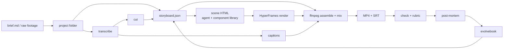
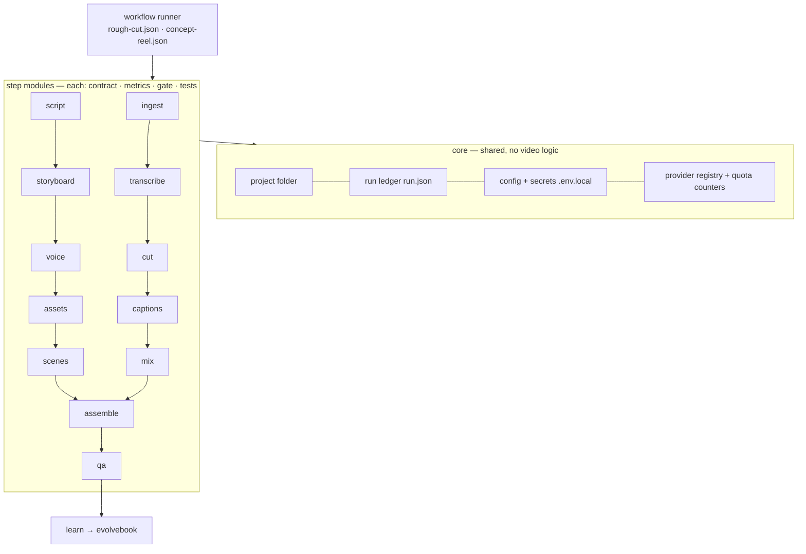

# mostudio — design

Date: 2026-11-09 · Status: reviewed (1 challenger pass), awaiting user approval · Owner: Mouad Belghiti · License: MIT

## 1. Intent

One open, portable agent skill plus a CLI that turns a brief or raw footage into a finished video, short or long, and gets better every run.

Why: the user's vault holds strong but scattered video know-how (kids-song pipeline, tubemauto, reel templates, Animate v4 rules, montage course material). Some of the best is under licenses that forbid sharing. The user wants one system they fully own, usable from any AI coding agent, publishable, later sellable.

### Jobs (all in scope long-term; v1 ships two of them end-to-end)

| Job | Short form | Long form |
|---|---|---|
| Explain a concept | 30–90 s reel (**v1**) | 5–15 min explainer |
| Teach a technical skill | 60 s tip | 10–30 min tutorial |
| Promote a product | 15–45 s promo | launch video |
| Teach a lesson | — | course video with chapters |
| Pitch for a program | 60–180 s pitch | — |
| Rough cut of raw facecam | — | 10–20 min YouTube rough cut (**v1**) |

## 2. Goals, non-goals, anti-goals

**Goals**
- G1: brief → publishable 60 s 9:16 concept reel in ≤ 15 min of user time (logged in `run.json`).
- G2: 10–20 min raw facecam → rough cut with captions and chapters in ≤ 30 min of user time.
- G3: portability through the CLI: every action is `mostudio <tool>` with JSON in/out; the skill is instructions on top. A smoke script passes in Claude Code, Codex and Gemini CLI. Web chats get a planning-only export (brief → script + storyboard).
- G4: ownership: MIT repo; every non-original part has a `docs/provenance.md` entry; clean-room parts pass the similarity check.
- G5: €0 per video by default. Core runs on free local tools; cloud AI only through free-tier keys (Google Gemini, Groq, xAI Grok, Pexels…). `billing: free-only` is the default and blocks any call that would be billed. Each provider has a daily quota counter; when a quota runs out the step falls back to the next provider (e.g. Groq STT → local whisper.cpp).
- G6: quality rubric scored after every video: hook clear in 3 s, pacing, caption errors ≤ 2 per minute, loudness −14 LUFS ±1 LU, no black/silent opening.
- G7: learning: ≥ 1 promoted rule or example per 3 runs, visible in the next run's choices.
- G8: render time: 60 s reel renders in ≤ 5 min on the user's M-series Mac.

**Non-goals (v1)**: own GUI editor, auto-publishing, hosted SaaS, own AI video engine, Remotion adapter, Stageshow, inspiration/taste engine, OTIO export, recipes other than the two v1 jobs, public launch.

**Anti-goals**: templated "AI video" look; lock-in to one agent or paid API; any key in chat or git (keys only in `.env.local`); reusing other creators' footage; shipping non-redistributable material.

## 3. Constraints

- macOS first, Linux supported.
- Node 22 + Python 3 + ffmpeg. Every new dependency needs user approval before install.
- Content languages: French, English, Moroccan Darija in Latin script (3/7/9 numerals), with code-switching.
- moskills standard applies (plans in `tasks/todo.md`, run-state proof, lessons, checkpoints). Impact logged in `docs/moskills-value.md`.

## 4. Architecture



### 4.1 How a storyboard becomes video (decided — hybrid)

- **Edit layer is deterministic.** Timing, cuts, captions, audio, assembly and mix are computed by the CLI from `storyboard.json`. Same input, same output.
- **Visual layer is agent-written.** For each visual scene the agent writes HyperFrames HTML, starting from a component in `components/` (reference examples, not a rigid template library). This is what avoids the templated look.
- Visual scenes are rendered as separate clips, then assembled by ffmpeg. This keeps the edit layer renderer-neutral and makes later NLE export easy.
- Renderers in v1: HyperFrames (Apache 2.0) for visuals, ffmpeg for everything else. Remotion dropped (needs a paid company license for commercial use).

### 4.2 storyboard.json (decided)

Neutral at the edit-decision level only. Fields:
- `meta`: job, mode (`short|long`), aspect, fps, target duration, language, platforms.
- `voice`: source (`recorded|tts|none`), transcript, word timings.
- `scenes[]`: id, start/end (seconds or word anchors), kind (`talking-head|broll|screen|graphic|title`), assets, captions on/off, `component` (id, renderer-specific allowed), notes.
- `audio`: music bed, SFX cues, ducking, loudness target.
- `chapters[]` (long mode).

### 4.3 Per-video project folder (decided)

```
projects/<YYYY-MM-DD-slug>/
  brief.md  storyboard.json  run.json
  media/      # inputs (footage, voice, stock)
  cache/      # transcripts, proxies, keyed by content hash
  scenes/     # agent-written HTML per scene
  renders/    # clips, final MP4, SRT, contact sheet
```
`run.json` records each step's status, inputs hash, timings (for G1/G2/G8), costs (G5) and rubric (G6). Every step is idempotent and resumable.

### 4.4 Modular architecture (decided)

Every functionality is a **step module**: one folder, one job, one contract. Workflows are ordered lists of steps. Nothing talks to anything except through files in the project folder.



**Step module contract (every step, no exception)**

| Part | Rule |
|---|---|
| Input | declared files in the project folder + JSON params, validated against `contract.json` |
| Output | declared files + `steps/<step>.json` (status, metrics, artifacts, provider used, quota spent, timings) |
| Metrics | numbers computed by the step itself (table below), written to the ledger |
| Gate | thresholds per metric → `pass`, `warn` (continue, flag to user) or `fail` (stop) |
| Providers | only through the registry (swap whisper.cpp ↔ Groq, Gemini ↔ Grok without touching the step) |
| Tests | fixtures in the module + a test that asserts metrics on them |
| Isolation | a step runs alone: `mostudio step <name> --project <dir>`; idempotent, cached by input hash |
| Language | process-level contract, so a step may be TypeScript or Python |

**Workflow runner**: reads `workflows/<name>.json` (ordered steps, per-step params and gate overrides), runs steps in order, stops on `fail`, resumes from the last passed step, and pauses at human checkpoints (`approve: true` on a step). `mostudio status --project <dir>` prints every step's status and metrics.

### 4.5 Repo layout

```
mostudio/                  # single root npm package (Node 22, TypeScript; modules are folders, since Node does not strip types inside node_modules); Python allowed per step
  core/                    # project folder, ledger, config, secrets, provider registry, quotas, gate engine
  steps/
    ingest/ transcribe/ cut/ captions/ mix/ assemble/ qa/          # rough-cut chain
    script/ storyboard/ voice/ assets/ scenes/                    # reel chain
    learn/                                                        # post-mortem → evolvebook
      each: contract.json · src/ · tests/ · fixtures/ · README.md (what it does, metrics, gate)
  providers/               # stt/ llm/ tts/ stock/ image/ — one adapter per service
  workflows/               # rough-cut.json, concept-reel.json
  components/              # HyperFrames scene examples
  cli/                     # `mostudio` entry: new, run, step, status, export-skill
  skill/                   # evolvebook-format skill on top of the CLI
  schemas/                 # storyboard, run ledger, step result, contract
  assets/                  # bundled assets with license field (OFL fonts, CC0 SFX only)
  docs/
```

## 5. Step modules, metrics and gates (v1)

| Step | Does | Key metrics | Default gate |
|---|---|---|---|
| ingest | import media, probe, proxy | duration, fps, resolution, audio present, hash | fail if no audio track |
| transcribe | word-level transcript | % words timestamped, mean confidence, runtime, WER on fixture | fail < 95 % timestamped; warn confidence < 0.7 |
| cut | silences, fillers, retakes (keep last take); quietest-point cuts, short fades | seconds removed %, cut count, mid-word cuts, shortest kept segment | fail if mid-word cuts > 0 |
| captions | SRT + styled burn-in, word highlight, Darija Latin normalization, human correction pass | chars/line, reading speed (chars/s), corrections made | warn > 17 chars/s; fail > 42 chars/line |
| mix | voice/music/SFX levels, ducking | integrated LUFS, true peak, ducking depth | fail outside −14 ±1 LUFS or peak > −1 dBTP |
| assemble | join clips, captions, audio; platform presets | duration vs target, A/V offset, preset match | fail A/V offset > 40 ms |
| qa | black/silent opening, contact sheet, rubric | black frames at start, silence at start, rubric score | fail black/silent opening; rubric shown to user |
| script | brief → script (reel) | words, estimated duration, hook length | warn hook > 3 s |
| storyboard | script → storyboard.json | schema valid, scene count, longest scene, timeline coverage | fail invalid schema; warn scene > 6 s (short mode) |
| voice | recorded or TTS (VoiceStudio, Gemini TTS) | duration vs target, loudness | warn duration ±15 % |
| assets | stock / user media per scene | scenes covered %, license recorded % | fail < 100 % license recorded |
| scenes | agent-written HyperFrames HTML → clips | clips rendered, render time, black frames | fail any clip missing |
| learn | post-mortem → evolvebook proposals | rules proposed, examples proposed | none (needs user approval) |

Gate thresholds are starting values; runs tune them through the evolvebook.

## 5b. Providers (free tier first)

Rotation across free-tier providers (source: user's "Free AI API Keys, Oct 2026" list). Most expose an OpenAI-compatible API, so one `openai-compat` adapter covers Groq, OpenRouter, Mistral, NVIDIA, Z.ai and Gemini; native adapters only for Gemini multimodal/TTS and Cloudflare.

| Capability | Chain (first with quota left wins) |
|---|---|
| STT | Groq Whisper (2,000/day) → Cloudflare Workers AI Whisper → local whisper.cpp |
| LLM text (scripts, storyboard) | Gemini Flash → Groq → Z.ai GLM Flash → OpenRouter `:free` → NVIDIA Build |
| Vision / video understanding (qa, v2 study) | Gemini Flash (native video) → Z.ai GLM-4.6V-Flash |
| TTS | recorded voice → VoiceStudio local API → Gemini TTS → ElevenLabs (only if key) |
| Image | Gemini image → Cloudflare Workers AI (Flux) → none |
| Stock | Pexels → Pixabay → Mixkit (manual) |

**Excluded or restricted**
- Cohere: trial key is non-commercial only → excluded (content is monetized, product may be sold).
- Mistral Experiment plan: requests may train their models → allowed only for non-private text (never transcripts of private footage, never client material).
- NVIDIA Build: one-time credits, not renewable → last resort only.

**Router rules**
- Route by capability, then by remaining quota (per-minute and per-day counters in the ledger, reset times per provider: Gemini midnight Pacific, Cloudflare 00:00 UTC).
- On HTTP 429: back off, mark provider exhausted until its reset, move to the next one.
- Each step pins a preferred provider + model for consistent output; fallback only on quota or error, and the step result records which provider and model produced the output.
- Each provider entry has flags: `commercial_ok`, `trains_on_data`, `renewable`. Steps declare `private: true` when inputs are private media; the router then skips providers with `trains_on_data`.
- One account per provider; no multiplying accounts to stretch quotas (against providers' terms).
- Long audio is chunked to fit provider file limits before STT.
- Limits are config values (`providers.yaml`), not code; checked against each limits page when a 429 pattern changes.

Keys live in `.env.local`. Final STT choice for Darija comes from spike S1.

Starting defaults (from the user's notes, tuned by runs): hook bed −12 dB, body music −21 dB with 3 s crossfades, SFX −16 to −19 dB, master −14 LUFS; motion 0.4 s ease; short-mode scenes ≤ 6 s; safe zones 150 px top / 170 px bottom / 60 px sides on 1080×1920; long mode: pattern interrupt every 30–60 s, J/L cuts, chapter markers.

## 6. Voice and visuals defaults (user decision)

- **Voice:** the user records it. If VoiceStudio is installed and its local API is running, `tts` uses it (local voice clone, free). ElevenLabs adapter only if a key is in `.env.local`.
- **VoiceStudio licensing:** AGPL-3.0. mostudio only calls its local API as a separate program; no VoiceStudio code is copied or linked, so mostudio stays MIT. Each voice model has its own license (see VoiceStudio `docs/model-credits.md`); the adapter shows the model's license before first commercial use.
- **Visuals:** our motion graphics (components) plus free stock (Pexels, Pixabay, Mixkit; API keys in `.env.local`). Each stock asset's source and license recorded in `run.json`. Paid AI generation only by opt-in, under the cost cap.

## 7. Reuse from tubemauto (user decision)

Port into mostudio under MIT (tubemauto is the user's own code): whisper.cpp wrapper, ffmpeg arg builders, captions and crop helpers (`packages/media`, `packages/providers`), TTS adapter pattern, clip inspection. Leave behind: Next web app, Fastify API, BullMQ, Postgres/Drizzle, MinIO, YouTube publisher. Before porting, check tubemauto for third-party code and keys; log each module in `docs/provenance.md`.

## 8. Clean-room rewrite (restricted material)

Needed only where v1 truly uses restricted ideas; silence cutting is common knowledge and is designed from first principles.
1. Agent A reads the restricted source, writes a behavior spec (inputs, outputs, rules, numbers; no code, no copied sentences). User reads the spec once.
2. Agent B implements in a **fresh session with memory plugins and vault access off**, with only the spec file.
3. Similarity check on code and prose; result logged in `docs/provenance.md`.
Animate v4 (CC BY 4.0) rules are reused as numbers with credit, not copied as text.

## 9. Evolution loop

- Skill in moskills evolvebook format. Initial Choices: `job`, `mode`, `hook_formula`, `caption_style`, `pacing`, `music_mood`.
- After each video: rubric (G6) + post-mortem. Mistake seen twice → proposed Never rule; good run → proposed Example; manual step in 3 runs → proposed Toolbox item. All need user approval.
- Seeded from vault lessons (kids-song pipeline, tubemauto, flow-mcp, reel templates, Animate v4 numbers).

## 10. Integrations

- yt-dlp: downloads YouTube for analysis (v2 study). IG/X/FB: tried without cookies; on failure the user drops the file in. Only derived metrics kept.
- Agent-Reach (MIT): not a dependency; optional "discover" adapter later.
- rea (MIT): not a dependency; optional aid for clean-room specs of closed tools.
- Stageshow (MIT, v1.1.1): v2, after a clock spike; fallback is recording a clip with its film script.

## 11. Delivery

| # | Step | Done when |
|---|---|---|
Built with moskills `modular-build`: one module at a time, each with its own run, proof and user acceptance before the next starts.

| # | Module | Done when (measured) |
|---|---|---|
| S1 | spike: STT on 3 real Darija/FR/EN clips (Groq large-v3, whisper.cpp large-v3, turbo) | WER and timestamp error measured; chain + correction rule chosen |
| S2 | spike: HyperFrames scene → clip → ffmpeg assemble | one 9:16 clip with captions and audio |
| 1 | core | ledger, config, registry, quotas, gate engine; unit tests pass |
| 2 | ingest | metrics correct on 3 fixtures |
| 3 | transcribe | gate passes on fixtures; Groq → whisper.cpp fallback tested |
| 4 | cut | 0 mid-word cuts on fixtures; removed % within ±5 % of a hand cut |
| 5 | captions | reading-speed and line gates pass; Darija normalization tested |
| 6 | mix | −14 ±1 LUFS on fixtures |
| 7 | assemble | A/V offset < 40 ms |
| 8 | qa | detects seeded black/silent openings |
| 9 | workflow runner + `rough-cut.json` | real 10–20 min rush meets G2 |
| 10 | script · 11 storyboard · 12 voice · 13 assets · 14 scenes | each module's gate passes on fixtures |
| 15 | `concept-reel.json` | real reel meets G1 and G8 |
| 16 | learn + skill | 3 real videos published, ≥ 1 rule promoted (G7) |

v2 (after v1 is used for real): inspiration folder + `study` + `taste.md`, other recipes, Stageshow, OTIO export (edit decisions + SRT + graphics clips on their own track), public launch with demo videos and page on belghitis.com.

Testing: fixtures per tool; golden briefs (1 reel, 1 rough cut in v1) re-rendered after changes; contact sheets compared by a person, rubric scores compared automatically (a drop of > 1 point fails).

## 12. Left to the builder

Internal module boundaries, CLI flag names, test framework, caption visual styles, component APIs, CI provider.

## 13. Review record

Pass 1 (2026-11-09): builder check (7 questions) + red-team (12 findings). Later user decisions: free-tier API keys only (€0 default, quota fallback, §5b); fully modular step architecture with metrics and gates per step (§4.4, §5). User decided: v1 = reel + long rough cut; extract tubemauto under MIT; voice recorded or VoiceStudio if installed, visuals free stock. Builder's calls (user can override): hybrid render model (§4.1), drop Remotion, project folder and run.json (§4.3), CLI as portability layer (G3), quality rubric (G6), Darija spike before tools, IG/X/FB without cookies, clean-room in fresh session, asset license policy.

Workflows are JSON, not YAML, to keep zero runtime dependencies (Node parses JSON natively).
