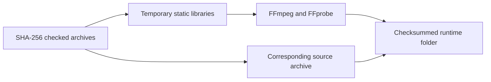

# Apple Silicon FFmpeg build

The source build targets macOS 12 on native Apple Silicon. It needs Xcode, CMake, and a standard macOS shell. It builds dependencies in temporary directories and leaves the system toolchain in place.



The same pinned archives feed the binaries and the corresponding source archive. The source archive also contains the build script and full license notices.

```sh
bash scripts/build-ffmpeg-mac.sh /tmp/mostudio-controlled-ffmpeg
cd /tmp/mostudio-controlled-ffmpeg
shasum -a 256 -c SHA256SUMS
```

The output path must be new. `MOSTUDIO_FFMPEG_CACHE` can point to an existing archive cache for an offline build. Source hashes come from the upstream release packages and Homebrew formula pins. The x264 archive is pinned by both the VideoLAN commit selected in Homebrew's x264 formula and its archive SHA-256.

The runtime enables libass subtitle rendering, x264 and VideoToolbox H.264 encoding, AAC, MP3 encoding and zimg color conversion. FreeType, HarfBuzz and FriBidi are linked into libass. FFmpeg's media network protocols are disabled. App provider calls use Node separately.

Before distributing the binaries, use the corresponding source and notices from the same build output. This build does not perform Developer ID signing or notarization.
