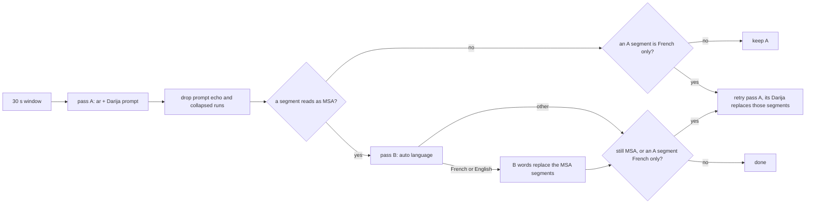

# transcribe

Word-level transcript of the ingested clip. Rotates free STT providers (Groq, Cloudflare Workers AI, local whisper.cpp) through core `withProvider`; the step is `private`, so only providers that do not train on data are picked.

- **Input:** `media/ingest.json` (and the media file it names). Params: `language` (optional ISO code; whisper-cpp uses `auto` when absent), `prefer` (optional provider id tried first), `prompt` (optional text sent to the model as context: names, tech terms; Groq `prompt`, Cloudflare `initial_prompt`, not whisper-cpp), `dialect` (optional; only `darija`, anything else fails; cannot be combined with `language`).
- **Outputs:** `transcript/audio.wav` (16 kHz mono PCM on the container timeline: a late audio start and timestamp gaps are padded with silence, so word times match the picture) and `transcript/words.json` (`{ language, provider, durationSec, words: {w,start,end,conf?}[], segments: {start,end,text}[] }`, source timeline, seconds).
- **Chunking:** audio longer than 600 s is cut near each 600 s mark at the quietest point within +-10 s (so a chunk may run up to 610 s). HTTP providers get mp3 64 kb/s mono chunks and whisper-cpp gets WAV chunks, both in `cache/transcribe/`. Each chunk goes through `withProvider` on its own and may land on a different provider; word times are offset by chunk start.
- **`dialect=darija`** (Moroccan Darija, code-switched with French/English): audio is split into ~30 s windows at the quietest point within +-5 s of each 30 s mark; a last window that would be under 10 s joins the one before it (a short, mostly silent window makes Whisper read the prompt back). Each window first runs pass A: `language=ar` plus a built-in Darija prompt (Arabic script with typical French/tech loanwords; your `prompt` is appended). Auto language rewrites Darija into Modern Standard Arabic, which pass A avoids. The choice is per segment: a segment of A reads as MSA (`readsAsMsa`, judged sentence by sentence) when a sentence has an MSA marker word (`سوف الذي هذا ذلك معكم لنا لكم أنهم الشأن`…) and no more Darija marker words (`ديال دابا هاد باش معاكم اللي ليكم ديالهم فهاد درت`…), or 10+ Arabic words with no Darija marker and no Latin word (garbled Arabic). Words that are Darija too (`حيث` because, `إلى` if, `يمكن` maybe, `لكي` from a mis-split `اللي كيخدموا`) are not markers, and `ولدي` (my son) is not `و`+`لدي`; lists reviewed with Gemini 4 Neon in `src/darija.ts`. Only then pass B runs with no language; if it detected French or English (forcing `ar` translates French speech into MSA, e.g. `وما إلى ذلك` for "etc."), its words replace those MSA segments. Segments still MSA after that, and segments of A that Whisper translated whole into French (`readsAsFrenchOnly`: no Arabic word, 6+ Latin words; pass B's own French is never retried), take a retry of pass A (its output varies run to run); its replacement must read as neither. A segment's replacement is the other pass's words whose midpoint is in the segment's span (halfway into the gap to the neighbouring words; where there is none, to the edge of the other pass's segments that overlap it, so a sentence end that A dropped comes back while a separate segment over a silent tail stays out), used only if they do not read as MSA themselves (same `readsAsMsa`); each word keeps the timing of the pass it comes from. A failing pass B or retry keeps what the window has. A window with no MSA or French-translated segment costs one call; the most is three. Each window's choices are logged. Code in `src/drift.ts`. Loanwords written phonetically in Arabic script (`الوتي` = outil) are normal; the `localize` step turns them into Latin script.


The diagram is one Darija window: every Groq/Cloudflare reply is filtered first (F); B runs only for windows with an MSA segment, the retry only for segments still MSA or translated into French, and each replaces only those segments.

- **Hallucination filter (always on):** a segment whose normalized text (lowercase, no punctuation or diacritics) equals, or is a run of whole words inside, a known Whisper silence line (`اشتركوا في القناة`, `ترجمة نانسي قنقر`, `thanks for watching`, Amara.org credits, ...) is dropped together with the words whose midpoint is inside it. List in `src/hallucinations.ts`.
- **Text with no speech under it (always on, per chunk/window, before a Darija pass is judged):** (1) **prompt echo**: a segment of 4+ words of which at least half sit in runs of 4+ words copied in order from the prompt sent with that call (built-in Darija prompt plus `prompt`) is dropped with its words; real speech sharing a few prompt words stays. (2) **collapsed runs**: 3+ consecutive words lasting <= 25 ms each are dropped, plus the next word when it ends its segment; Groq's whisper-large-v3 aligns a repeated sentence, or a French translation of the line before it, this way (20 ms per word, no audio left for it). A segment that loses words keeps the text and span of the words left, or goes. Words belong to segments in transcript order when the segment texts split on spaces are exactly the words (every Groq reply seen; Groq can time a segment's last words past the next segment's start), else to the last segment starting at or before their midpoint. Code in `src/echo.ts`.
- **Silent audio:** when no 10 ms window of the audio rises above -60 dBFS the clip is not sent to any provider (Whisper invents "Thank you." over silence): zero words, and the step fails with `no words in transcript` (shown as "No speech found") instead of failing later at the mix.
- **Metrics:** `wordCount`, `pctTimestamped`, `meanConfidence` (1 with `confidenceKnown: false` when the provider gives none, e.g. whisper-cpp), `language`, `chunks`, `runtimeSec`, `provider` (the one that served most chunks), `nonSpeechDropped`, `silentAudio`, `hallucinationsDropped` (segments), `promptEchoDropped` and `collapsedDropped` (words); with `dialect`: `windows`, `autoWindows` (windows where pass B replaced a segment), `autoSegments` (segments replaced by pass B), `retrySegments` (segments replaced by the pass A retry).
- **Gate:** `pctTimestamped >= 95` fail, `wordCount > 0` fail (music-only clip), `meanConfidence >= 0.7` warn. Zero words still writes `words.json` with `words: []`.
- **Binaries:** ffmpeg via `resolveFfmpeg`; `whisper-cli` via `WHISPER_CLI`; models from `WHISPER_MODELS_DIR` (`ggml-<model>.bin`). Cloudflare needs `CLOUDFLARE_ACCOUNT_ID`.

```
mostudio step transcribe --project <dir> [--param language=en] [--param prefer=whisper-cpp]
mostudio step transcribe --project <dir> --param dialect=darija [--param "prompt=mostudio, HyperFrames"]
```
